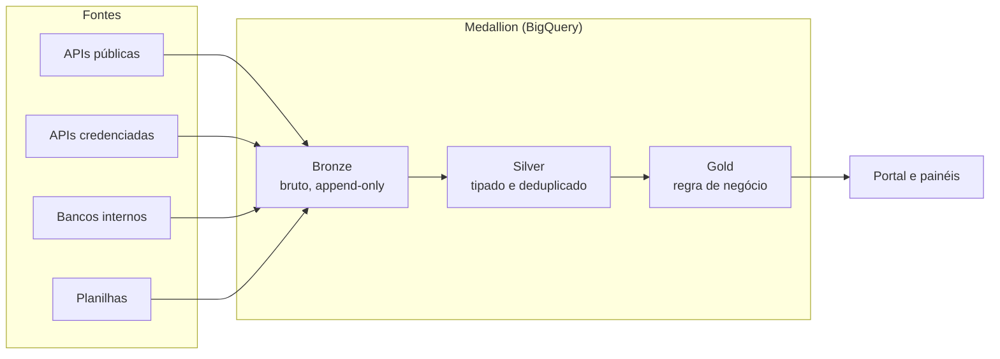

# AlupData — Fase 1: DataLake

**Desenvolvido por <span style="font-family: 'Montserrat', sans-serif; font-weight: 500;">ness<span style="color: #00ade8;">.</span></span>**

> Repositório centralizado de dados operacionais e de mercado do Grupo Alupar.
> Arquitetura Medallion (Bronze → Silver → Gold) na Google Cloud Platform.

## Visão geral

| Item | Detalhe |
|------|--------|
| **Contrato** | CPS-01025/2026 |
| **Contratantes** | FGE, IJUI, FOZ, QUELUZ, LAVRINHAS, VERDE 08 (Grupo Alupar) |
| **Contratada** | ness. Processos e Tecnologia |
| **Prazo** | kickoff em 27/08/2026, em 5 ondas, até 08/01/2027 |
| **Stack** | Python · BigQuery · Cloud Storage · Dataform · Cloud Run · Cloud Scheduler · Terraform |

Cada fonte de dados só está entregue com os **7 componentes** da cláusula 2ª do contrato: conector Python, tabela Bronze, view Silver, view Gold,
testes, agendamento e dicionário com linhagem.

## Estado atual (22/10/2026)

| Onda | Tema | Janela | Estado |
|------|------|--------|--------|
| 0 | Fundação e arquitetura | 31/08 a 11/09 | **Aprovada** (05/10) |
| 1 | Inteligência de mercado: APIs públicas | 14/09 a 16/10 | **Aprovada** (05/10); IPDO e ACOMPH sem entrega |
| 2 | APIs com credenciais | 19/10 a 13/11 | **Em andamento**: Hubspot carrega; BBCE sem credencial; CCEE credenciada sem código; TempoOK fora do escopo |
| 3 | Sistemas internos | 16/11 a 18/12 | **Em andamento**: 2 de 3 bancos conectam; Oracle FMB depende de rede via terceiro |
| 4 | Planilhas, governança e handoff | 21/12 a 08/01/2027 | **Em andamento**: motor de planilhas pronto; leitor do Google Drive a escrever |

| Medida | Valor |
|---|---|
| Conectores registrados | **56**, todos com os 7 componentes presentes |
| Testes | **2.013 aprovados** e 558 ignorados por desenho |
| Cobertura de linhas | **96%** |
| Ambientes | `dev` e `hml` aplicados; produção ainda não existe |
| Saúde da ingestão | dev: 56 fontes OK; hml: 55 |

Visão de uma página: [`docs/visao-consolidada.md`](docs/visao-consolidada.md). Relatório com as evidências:
[`docs/relatorios/2026-10-22-situacao-consolidada.md`](docs/relatorios/2026-10-22-situacao-consolidada.md). Histórico e pendências:
[`docs/status.md`](docs/status.md).

## Para auditar

O guia [`docs/auditoria.md`](docs/auditoria.md) lista cada controle (7 componentes, SAST, SCA, segredos, acesso, mudança, LGPD), onde está a evidência
e o comando que a reproduz. O essencial:

```bash
uv sync --frozen --extra dev --extra bancos
make componentes      # confere os 7 componentes de cada fonte registrada
make ci               # lint, testes, atribuição, Bandit, Gitleaks, Terraform, Dataform e pip-audit
uv run pytest tests/ --cov=src
gh workflow run "Conferir cargas" -f environment=dev   # estado do dado no BigQuery, somente leitura
```

## Fontes por origem

| Origem | Conectores | Tipo | Onda |
|---|---|---|---|
| ONS | 29 | arquivos e APIs públicas | 1 e aditivo 01 |
| CCEE (dados abertos) | 17 | CKAN público | 1 e aditivo 01 |
| BCB, IBGE, ANEEL, INMET, ACE | 8 | APIs e arquivos públicos | 1 |
| Hubspot | 1 | API credenciada | 2 |
| BBCE | 1 | API credenciada | 2 |
| TempoOK | 2 | API credenciada (fora do escopo desde 20/10) | 2 |
| CCEE credenciado | 0 | a definir | 2 |
| Oracle FMB, MySQL Alup, MySQL Comercialização, RM/TOTVS | 0 | bancos e sistemas internos | 3 |
| Planilhas (CSV e XLSX) | motor pronto | arquivos da Alupar | 4 |

O contrato mantém **13 fontes**; entidade implementada não cria uma fonte contratual nova. O índice completo, com linhagem, está em
[`docs/dicionario-dados/README.md`](docs/dicionario-dados/README.md).

## Arquitetura



Decisões e o porquê de cada uma: [`docs/arquitetura/decisoes/`](docs/arquitetura/decisoes/) (30 ADRs). Visão geral:
[`docs/arquitetura/visao-geral.md`](docs/arquitetura/visao-geral.md).

## Estrutura do repositório

```
alupdatalake/
├── src/             # conectores (src/conectores/) e framework de ingestão (src/core/)
├── definitions/     # Dataform: Bronze, Silver, Gold e asserções
├── infra/           # Terraform de tudo que existe na GCP
├── tests/           # pytest, unitários e de integração
├── scripts/         # conferências, painel e ferramentas de apoio
├── painel/          # dados do painel público de acompanhamento
├── cloudbuild/      # CI no Cloud Build (ADR 030)
├── certs/           # pacote público de CAs do RDS, usado pelo TLS verificado
├── docs/            # contrato, arquitetura, runbooks, relatórios e planos
└── .github/         # templates e workflows
```

## Primeiros passos

```bash
git clone https://github.com/nessenergy/alupdatalake.git
cd alupdatalake
uv sync --extra dev
pre-commit install --hook-type pre-commit --hook-type commit-msg

make test
make lint

# ingestão: o mesmo comando roda local e no Cloud Run Job
uv run alupdata listar
uv run alupdata ingerir ons_carga --de 2026-01-01 --ate 2026-01-31 --dry-run
```

| Comando | O quê |
|---|---|
| `make all` | lint, testes, Bandit e pip-audit, antes de todo PR |
| `make ci` | as etapas do CI, na ordem (ADR 030) |
| `make componentes` | os 7 componentes de cada fonte registrada |
| `make novo-conector fonte=X entidade=Y` | esqueleto dos 7 componentes |
| `make dataform-compile` | compila o Dataform sem credencial |
| `alupdata reprocessar-raw ...` | revalida um bruto do GCS sem chamar a fonte de novo |

## Regras do projeto

As seis regras que não se negociam estão em [`AGENTS.md`](AGENTS.md) (que vale para qualquer agente de código, seja qual for a ferramenta):

1. toda fonte entrega os 7 componentes;
2. credencial só pelo Secret Manager;
3. ingestão sempre por janela de datas;
4. Bronze append-only, particionada e clusterizada, com a deduplicação na Silver;
5. recurso GCP que não está em `infra/` não existe;
6. nenhuma atribuição de ferramenta automatizada em commit, PR, issue ou documento.

## Segurança

| Ferramenta | Função | Cláusula |
|-----------|--------|----------|
| Bandit | SAST, análise estática de segurança | 8.4 |
| pip-audit | SCA, vulnerabilidades em dependências | 8.4 |
| Gitleaks | detecção de segredos no código e no histórico | 8.5 |
| Secret Manager | gestão de credenciais na GCP | 8.5 |

Detalhes: [`docs/arquitetura/seguranca.md`](docs/arquitetura/seguranca.md). Política de divulgação: [`SECURITY.md`](SECURITY.md).

## Documentação

| Assunto | Onde |
|---|---|
| Visão consolidada e relatório atual | [`docs/visao-consolidada.md`](docs/visao-consolidada.md) e [`docs/relatorios/`](docs/relatorios/) |
| Guia de auditoria | [`docs/auditoria.md`](docs/auditoria.md) |
| Estado, plano e fila de execução | [`docs/status.md`](docs/status.md), [`docs/plano-execucao.md`](docs/plano-execucao.md), [`docs/proximos-passos.md`](docs/proximos-passos.md) |
| Contrato resumido | [`docs/contrato/resumo-contrato.md`](docs/contrato/resumo-contrato.md) |
| Dicionário de dados e linhagem | [`docs/dicionario-dados/`](docs/dicionario-dados/README.md) |
| Operação | [`docs/runbook/`](docs/runbook/) (deploy, incidentes, credenciais, conferência e sondas, rede) |
| LGPD | [`docs/lgpd/`](docs/lgpd/) |
| Interlocutores e responsabilidades | [`docs/interlocutores.md`](docs/interlocutores.md) e [`docs/raci.md`](docs/raci.md) |
| Como contribuir | [`CONTRIBUTING.md`](CONTRIBUTING.md) e [`docs/onboarding.md`](docs/onboarding.md) |
| Glossário | [`docs/glossario.md`](docs/glossario.md) |

O acompanhamento diário da equipe acontece no canal Alup Datalake do Teams. O painel público de acompanhamento é gerado a partir de
[`painel/marcos.toml`](painel/marcos.toml).

## Licença

Proprietário. Desenvolvido sob o contrato CPS-01025/2026 para o Grupo Alupar.
